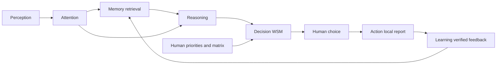

# NetGuard Cognitive DSS

**Русская версия:** интерфейс и PDF-презентация переведены на русский. Инструкции по запуску и демонстрации — в [README_RU.md](README_RU.md). Технические поля CSV/JSON и существующая память совместимы с прежней версией.

An offline network incident triage system for a SOC analyst. The analyst compares **Monitor**, **Analyst review** and **Quarantine proposal**, adjusts benefit/cost priorities, reviews the explanation and makes the final decision. A confirmed decision saves a real local report. Verified feedback changes subsequent risk estimates and recommendations.

## Start on a clean machine

Use **Python 3.10–3.12** (tested on Windows with Python 3.12.14). Python 3.14 is not compatible with these pinned NumPy/scikit-learn versions. No API key, Internet access at runtime, GPU, Docker or external service is required. Internet is needed once to install packages.

```powershell
cd C:\Users\User\Downloads\NetGuard-cognitive
python -m venv .venv
.\.venv\Scripts\python.exe -m pip install -r requirements.txt
.\.venv\Scripts\python.exe -m streamlit run streamlit_app.py --server.address 127.0.0.1
```

Open http://localhost:8501. For this prepared local copy, double-click `RUN_WINDOWS.cmd`. In an activated environment the required course command works directly:

```text
streamlit run streamlit_app.py
```

Linux/macOS: replace `.venv\Scripts\python.exe` with `.venv/bin/python`. `requirements-lock.txt` records the exact verified environment; `requirements.txt` contains the direct pinned dependencies.

## A complete cognitive cycle

| Stage | Separate implementation | Input → output and downstream use |
|---|---|---|
| T1 Perception | `cognitive/perception.py` | UTF-8 CSV or NSL-KDD record → 41 cleaned features, 5 derived signals and audit. Label/difficulty never enter inference. |
| T2 Attention | `cognitive/attention.py` | Signals → top-k by signal × importance. Only selected contributions enter the risk index. |
| T3 Memory | `cognitive/memory.py` | Attended protocol/service → recent reports and verified attack/benign statistics in SQLite. These change reasoning. |
| T4 Reasoning | `cognitive/reasoning.py` | Attended risk + learned posterior → explicit inference trace and risk level. Risk generates criterion estimates. |
| T5 Decision-making | `cognitive/decision.py` | Alternatives, criteria, user weights → WSM scores, ranking, recommendation, contribution explanation and sensitivity. |
| T6 Action | `cognitive/action.py` | Evaluated cycle + final human choice + confirmation → actual local JSON report and SQLite audit record. |
| T7 Learning | `cognitive/learning.py` | Saved action + verified outcome → persisted Beta posterior, before/after risk and decision comparison. Next evaluation retrieves it. |

`cognitive/pipeline.py` connects stages 1–5. The Action and Learning tabs explicitly complete stages 6–7. Streamlit reruns evaluation on interactions without silently approving actions, adding reports or inventing feedback. The seven numbered tabs expose every stage's result. The current recommendation and risk stay visible above the tabs.



## Decision model and assumptions

The three criteria have fixed **0–100** anchors: **Protection** is a benefit, **Disruption** and analyst **Effort** are costs. Larger Protection is better; smaller costs are better. Raw weights must be finite and nonnegative, with a positive sum. They are normalized to sum to one.

For benefit: `u = x/100`. For cost: `u = 1 - x/100`. Final score: `S(alternative) = sum(normalized_weight × u)`. The largest score wins. Exact ties use alphabetical order, disclosed in the explanation. The implementation rejects invalid matrices, missing criteria, NaN, infinity, negative weights and all-zero weights.

Fixed anchors preserve absolute risk differences and avoid changing a score solely because another alternative is added to the comparison set. WSM is chosen for a transparent, compensatory tradeoff; it assumes linear utilities and permits high performance on one criterion to offset poor performance on another. It does **not** enforce mandatory security constraints.

Default weights are 0.60 / 0.25 / 0.15. With risk `r`, initial Protection estimates are `100*r*[0.10, 0.65, 0.95]`; Disruption is `[1,12,75]*(1-0.6*r)`; Effort is `[3,40,10]`. These are **explicit scenario assumptions**, not measured intervention effectiveness. All values are editable in the matrix expander. Changing traffic, attention or learned evidence resets the editor to the newly generated matrix.

The DSS tab shows the ranking, normalized values, weighted contributions and winner-versus-runner-up margin. Independent what-if sliders immediately compare a scenario against current baseline weights without approving a decision. A 21-point Protection-weight sweep shows all three score curves. Remaining weights retain their relative proportion (50/50 when both baseline remaining weights are zero).

## Real feedback learning and memory

The attended signal index is `0.08 + 0.87 * sum(selected importance * signal)`. Rule importance values are assumptions, not learned neural attention. Historical predictions are never treated as verified attack labels.

For each protocol/service pattern the model starts from a **Beta(1,1)** prior. Each verified attack increments alpha; each verified benign outcome increments beta. The posterior mean is `alpha/(alpha+beta)`. Evidence influence is `s = min(0.65, n/(n+2))`; the new risk is `(1-s)*signal_risk + s*posterior`. No feedback gives `s=0`. SQLite stores the actual labelled reports and retrieves sufficient statistics, so the update survives application restarts. A unique report id prevents learning twice from the same feedback submission. SQL parameters bind all inputs.

This is online statistical pattern learning, **not retraining the legacy Random Forest**. The risk index is not a calibrated attack probability. Learning changes behavior but does not itself prove better detection accuracy. Feedback can be biased or poisoned, and coarse protocol/service matching can mix unrelated hosts. Human verification and the bounded influence reduce, but do not eliminate, these risks.

### Reproducible learning demonstration

```powershell
.\.venv\Scripts\python.exe -m scripts.demo_learning
```

The isolated demo uses `ambiguous_http` and four explicitly supplied benign labels in a temporary database, leaving live memory untouched. Expected risk: **0.654200 → 0.547244 → 0.452100 → 0.381680 → 0.337303**. The default recommendation changes **Quarantine proposal → Analyst review** after three outcomes. The UI has the same demonstration button. This is a controlled adaptation example, not a held-out quality experiment.

For actual use, save an approved report in Action and label its outcome in Learning. The before/after display compares the stored action to current learned state with fixed weights and other criterion values. Protection scales with the risk change, preserving manual relative adjustments; the next full evaluation regenerates all default estimates.

## Input and safe action

- `data/demo_flows.csv`: five **synthetic fixtures** including normal FTP, ambiguous HTTP, SYN flood, service scan and failed logins. Downloadable as an upload template.
- CSV upload: UTF-8, header required. Required fields: `protocol_type,service,flag,src_bytes,dst_bytes,count,serror_rate,diff_srv_rate`. Missing optional numeric features default to zero with a visible audit. Bad numeric values and blank categories are rejected; negatives/rates outside their domains are clipped and audited.
- NSL-KDD TXT upload: exactly 43 columns without a header. Maximum upload 5 MB / 10,000 rows. The built-in sample replays the first 1,000 rows of the existing test set. These are offline dataset records, **not live packet capture**.
- The Action tab writes `runtime/reports/<random-id>.json` and `runtime/cognitive.sqlite3` only after explicit confirmation. The analyst can override the recommendation. It performs **no firewall modification, actual quarantine, network notification or external API call**. Downloadable JSON includes features, reasoning, retrieved memory, matrix, weights, ranking and human choice.
- `NETGUARD_RUNTIME_DIR` can redirect the new system's database and reports. The default is local to the project. Reports can contain sensitive traffic information; protect or anonymize your own uploads. The classroom demo has no authentication or multiuser access policy.

## Preserve and run the original NetGuard

Existing notebooks (`notebook/main.ipynb`, `notebook/cognitive.ipynb`), NSL-KDD datasets, browser frontend, figures and research materials are retained. The original README is in `docs/original/README.md`, original server in `docs/original/server.py`, and original research dependencies in `requirements-research.txt`.

The supplied `random_forest.pkl`, `scaler.pkl`, `label_encoders.pkl` and `tabpfn_model.pkl` are **Git LFS pointers**. They are preserved intact. Working compatibility artifacts were rebuilt into `results/models/rebuilt/` using the existing train split, 80-tree Random Forest, seed 42. Scaler and encoders fit training data only. The legacy server prints that it uses rebuilt artifacts when pointers are detected. Reproduce with:

```powershell
.\.venv\Scripts\python.exe -m scripts.rebuild_models
.\.venv\Scripts\python.exe -m uvicorn demo.server:app --host 127.0.0.1 --port 8000
```

Open http://localhost:8000. Existing stream, injection, analysis and memory API routes remain available and are regression-tested. `NETGUARD_LEGACY_MEMORY_PATH` redirects legacy JSON memory for isolated testing. “Enforcement” labels in the old UI are **simulation labels**, not real network changes. Original documentation describing actual packet traversal or quarantine overstates that behavior.

The rebuilt RF's independently held-out NSL-KDD test metrics are stored in `results/models/rebuilt/metrics.json`: accuracy **0.7738**, precision **0.9682**, recall **0.6232**, F1 **0.7583**, ROC AUC **0.9709** on **22,544** test rows, trained on **125,973** rows. These metrics describe the **legacy RF**, not the new heuristic DSS or learning effectiveness. No old experimental result is claimed as a newly reproduced result. TabPFN and GNN/Transformer research are retained but not required for the new UI; their original research environment is separate and has not been reproduced here.

## Tests and verification

```powershell
.\.venv\Scripts\python.exe -m pytest -q
```

Tests cover hand-computed benefit/cost WSM results, invalid weights/matrices, deterministic ties, attention affecting reasoning, label exclusion, malformed input, safe human confirmation, actual report output, feedback deduplication, persistence, pattern isolation, behavior change, Streamlit interactions and existing FastAPI endpoints. Tests isolate memory under temporary directories. See `docs/VALIDATION.md` for the final recorded result and limitations.

Streamlit interaction checks use the official [AppTest interface](https://docs.streamlit.io/develop/api-reference/app-testing/st.testing.v1.apptest). They complement a real local server health check; neither substitutes for the student's required live desktop demonstration.

## Submission and defense

- `submission/NetGuard_Cognitive_DSS.zip`: source, requirements, tests, demo/test data, existing project materials, rebuilt compatibility models, docs and PDF. No virtual environment, private runtime memory or temporary build data.
- `submission/NetGuard_Cognitive_DSS.pdf`: at most 10 visual slides. Claims distinguish implemented components, scenario assumptions, measured legacy RF metrics and future production work.
- `docs/DEFENSE_GUIDE_RU.md`: timed 5-minute presentation, 2-minute UI path and Q&A notes.
- `docs/REQUIREMENTS_TRACEABILITY.md`: assignment criterion to implementation and evidence. The live performance and oral understanding criteria remain for the student/examiner to assess; no grade is promised.

Original authorship and research attribution remain in the preserved README and existing materials. Verify the final team roster before submission.
